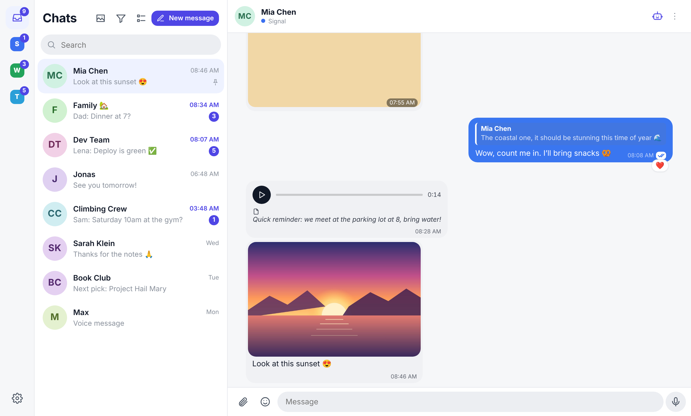
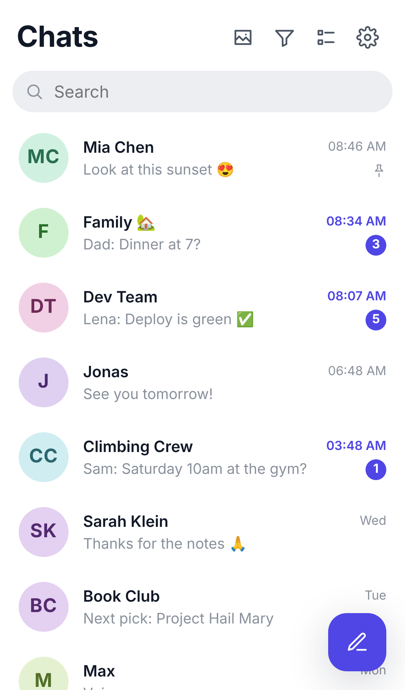
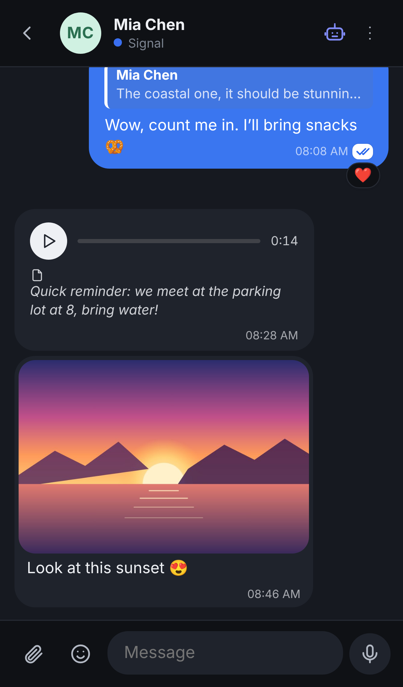
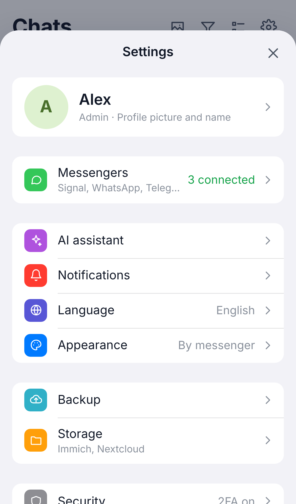

<p align="center">
  
</p>

<h1 align="center">Chorus</h1>

<p align="center">
  <b>Signal, WhatsApp, Telegram und E-Mail in einem ruhigen, selbst gehosteten Posteingang.</b><br />
  Auf deinem eigenen Server · verschlüsselt gespeichert · als App aufs Handy installierbar
</p>

<p align="center">🇬🇧 <a href="README.md">English version</a></p>

<p align="center">
  
</p>

<p align="center">
  
  &nbsp;
  
  &nbsp;
  
</p>

> **Mit Claude gebaut.** Chorus entsteht zusammen mit [Claude](https://claude.ai), dem KI-Modell von Anthropic, über Claude Code. Ein Mensch entscheidet, was gebaut wird, und testet es jeden Tag; den Großteil des Codes schreibt Claude.

Chorus läuft als Docker-Container auf deinem eigenen Server (Raspberry Pi, NAS, kleiner VPS, Proxmox-Container), im Browser am Computer und als installierbare App auf dem Handy. Die Oberfläche gibt es auf **Deutsch und Englisch**: automatisch nach Gerätesprache, umstellbar unter Einstellungen → Sprache.

| Messenger | Stand |
| --- | --- |
| Signal | ✅ QR-Code, als gekoppeltes Gerät |
| WhatsApp | ✅ QR-Code oder Kopplungscode, inoffiziell über Baileys |
| Telegram | ✅ QR-Code oder Telefonnummer |
| E-Mail | ✅ IMAP/SMTP: Absender als Kontakt, Betreffe als Chats |

## Was die App kann

### Nachrichten
- **Ein Posteingang** für alle Chats, filterbar nach Messenger (auch mehrere) oder „Ungelesen“
- Antworten, Reaktionen, Bearbeiten, Löschen, **Weiterleiten** (auch messengerübergreifend), Lesebestätigungen, angepinnte und stumme Chats, Entwürfe pro Chat
- **Wischen** am Handy: links löschen, rechts archivieren, weit rechts gelesen/ungelesen. Lange drücken für Mehrfachauswahl
- **Archiv**, das still bleibt: archivierte Chats zählen nicht im Badge und melden sich nicht
- **Kontaktprofile** mit eigenem Namen, Bild und Notiz; Nummer, Status und Mitglieder kommen vom Messenger
- **Kontakte zusammenführen**: dieselbe Person bei Signal und WhatsApp wird ein Chat mit gemeinsamem Verlauf
- **Später senden**: Senden gedrückt halten und Zeit wählen
- **Erinnerungen** an jede Nachricht, mit Benachrichtigung, die direkt zurück in den Chat springt
- Fehlgeschlagene Nachrichten zeigen den Grund, mit **Erneut senden** und **Löschen**
- **Suche über alle Messenger**: Nachrichten, Transkripte und Dateinamen, mit Sprung zum Treffer
- **Galerie** mit allen Fotos, Videos, Dateien, Links und Sprachnachrichten, pro Chat oder über alle

### Medien
- Fotos, Videos, Sprachnachrichten und Dateien senden (am Computer auch per Drag & Drop oder Einfügen)
- Mehrere Fotos hintereinander erscheinen als **Mosaik**, das Vollbild blättert durchs Album, Doppeltippen zoomt
- **Bildeditor** vor dem Senden: Zuschneiden, Drehen, Spiegeln, Stift, Marker, Pfeile, Formen, Text, Verpixeln
- **Videoeditor**: Kürzen und Zuschneiden (1:1, 4:3, 16:9, 9:16), geschnitten auf dem Server mit ffmpeg
- **Dateivorschau** in der App (PDF, Text) mit Teilen/Sichern
- Sprachnachrichten mit 1,5×/2× und Mini-Player, der beim Chatwechsel weiterspielt
- **In Immich oder Nextcloud speichern** (freiwillig): Fotos und Videos mit einem Tipp nach Immich, Dateien mit Ordnerauswahl nach Nextcloud; beim Anhängen Fotos aus Immich (Neueste, Alben, Smart-Suche) oder Dateien aus Nextcloud wählen

### KI-Assistent (freiwillig, pro Chat)
Mit eigenem Schlüssel für **Claude** ([Anthropic](https://console.anthropic.com)) oder **ChatGPT** ([OpenAI](https://platform.openai.com)), oder einem **OpenAI-kompatiblen** Dienst wie Ollama, LM Studio oder OpenRouter, auch lokal ohne Schlüssel. Sprachfunktionen laufen über [ElevenLabs](https://elevenlabs.io).
- **Zusammenfassen**: worum es geht, was vereinbart ist, was offen ist
- **Antwortvorschläge** als Chips über dem Eingabefeld, auf Wunsch mit Richtung („freundlich absagen“)
- **Schreiben lassen**: „sag, dass ich beim Sport bin und mich später melde“ eintippen oder einsprechen, dann als Text oder als Sprachnachricht **in deiner eigenen (geklonten) Stimme** senden; KI-Texte lassen sich mit 🤖 markieren
- **Abtippen** von Sprachnachrichten
- **Live-Übersetzung** pro Chat: fremdsprachige Nachrichten bekommen eine Übersetzung in deine Sprache, deine Antworten gehen in der Sprache des Gegenübers raus
- **Chats fragen**: „Wann wollte Lisa vorbeikommen?“ liefert eine Antwort samt den Nachrichten, auf denen sie beruht
- **Autobot**: die KI antwortet in deinem Namen bis zu einem Limit; in Gruppen legst du fest, worauf, von wem, unter welcher Bedingung und in welchem Stil

Einrichten unter Einstellungen → KI-Assistent. Die KI ist in jedem Chat aus, bis du sie dort erlaubst, und die Freigabe lässt sich jederzeit zurücknehmen.

### Alltag
- Installierbare **PWA** mit Push-Benachrichtigungen, Hell- und Dunkelmodus
- **Darstellung**: Blasenfarben je Messenger oder einheitlich (Palette oder eigene Farbe), **Chat-Hintergründe** (Vorlagen oder eigenes Foto), Sende-Animation wie bei iMessage
- **Mehrere Profile** für Familie und Freunde (siehe unten)
- **Export** des Verlaufs als HTML oder ZIP, Medien automatisch sichern
- Verwaltung: Serverzustand, letzte Warnungen, Messenger neu verbinden, Neustart

## Sicherheit: der Tresor

Beim ersten Start legst du ein Passwort fest. Daraus erzeugt **dein Browser** einen Schlüssel. Damit sind alle Chats, Dateien und Zugangsdaten auf dem Server verschlüsselt (Datenbank: SQLCipher, Dateien: AES-256-GCM).

- Der Server speichert den Schlüssel **nicht**. Nach einem Neustart ist alles gesperrt, bis du die App wieder öffnest.
- Signal und WhatsApp liefern Nachrichten, die in dieser Zeit ankommen, nach.
- Optional gibt es den **Komfort-Modus** (Einstellungen → Sicherheit). Dann empfängt der Server auch nach einem Neustart sofort, legt dafür aber einen Schlüssel auf der Platte ab.
- Beim Einrichten bekommst du einen **Wiederherstellungscode**. Gut aufbewahren: Ohne Passwort und ohne Code sind die Daten weg.
- **Zwei-Faktor-Anmeldung** (Einstellungen → Sicherheit): Zusätzlich zum Passwort fragt Chorus nach einem Code aus einer Authenticator-App (2FAS, Aegis, Google Authenticator, 1Password …). Geräte, denen du „30 Tage vertraust“, fragen erst danach wieder. Handy verloren? Mit dem Wiederherstellungscode kommst du rein, die Zwei-Faktor-Anmeldung wird dabei ausgeschaltet und du richtest sie neu ein.
- Nach 10 Fehlversuchen in 10 Minuten nimmt Chorus von dieser Adresse 5 Minuten lang keine Anmeldung mehr an. Bei vielen Fehlversuchen von verschiedenen Adressen wird jede Anmeldung gebremst, aber niemand ausgesperrt.
- Wenn Chorus aus dem Internet erreichbar ist: im Reverse Proxy HTTP auf HTTPS umleiten und HSTS einschalten (im Nginx Proxy Manager „Force SSL“ und „HSTS Enabled“).

## Profile für Familie und Freunde

Eine Chorus-Installation kann mehrere Personen bedienen. Jede Person hat ein eigenes Profil mit eigenem Passwort, eigener Zwei-Faktor-Anmeldung, eigenen Messengern und eigenen KI-Schlüsseln. Jedes Profil ist getrennt verschlüsselt, auch der Admin kann fremde Chats nicht lesen.

- Wer Chorus zuerst einrichtet, ist Admin.
- Neue Profile legt der Admin an: Einstellungen → Profile → Name eingeben → „Profil anlegen“. Den Einladungslink schickst du der Person. Sie legt beim ersten Öffnen ihr eigenes Passwort fest, der Code gilt nur einmal.
- Bei der Anmeldung wählt jede Person ihr Profil aus.
- Wer von einer Version ohne Profile kommt: Der bestehende Tresor wird automatisch das erste Profil (Admin), es geht nichts verloren. Den Namen dafür setzt `FIRST_PROFILE_NAME` (z. B. `FIRST_PROFILE_NAME=Wayne docker compose up -d`), umbenennen geht später auch in den Einstellungen.
- Pro Profil mit Signal läuft ein eigenes signal-cli (etwa 200–300 MB Arbeitsspeicher).

## Installation

Voraussetzung: ein Server mit Docker (z. B. Ubuntu, Debian, Synology, Unraid).

```bash
mkdir chorus && cd chorus
curl -O https://raw.githubusercontent.com/robinvonmises/chorus/main/docker-compose.yml
docker compose up -d
```

Chorus läuft dann als einfaches HTTP auf **`http://<IP-deines-Servers>:8080`**. Den eigenen Reverse Proxy (nginx, Caddy, Traefik, Nginx Proxy Manager …) einfach auf diesen Port zeigen lassen.

> **Warum trotzdem HTTPS empfohlen ist:** Über reines HTTP (außer `localhost`) erlauben Browser kein Mikrofon (Sprachnachrichten aufnehmen, Aufträge einsprechen), keine App-Installation und keine Benachrichtigungen. Alles andere funktioniert, auch der Tresor.

**Ohne eigenen Proxy** gibt es HTTPS mit selbst erstelltem Zertifikat auf Port 8443:

```bash
curl -O https://raw.githubusercontent.com/robinvonmises/chorus/main/Caddyfile
docker compose --profile https up -d
```

Wer von einer älteren Version kommt und HTTPS nicht mehr braucht, entfernt den alten Caddy-Container einmalig mit `docker compose --profile https rm -s -f https`.

### Ohne Docker (z. B. Proxmox-LXC)

Auf Debian/Ubuntu als root:

```bash
git clone https://github.com/robinvonmises/chorus.git && cd chorus
bash deploy/install-ohne-docker.sh        # erneut ausführen = Update
```

Das Skript installiert Node.js, signal-cli, ffmpeg und Caddy, richtet den Dienst `inbox` ein und meldet die Adresse. Daten liegen in `/var/lib/inbox`.

### Port ändern

```bash
PORT=9000 docker compose up -d
```

### Von unterwegs erreichbar machen

Am einfachsten mit [Tailscale](https://tailscale.com): auf Server und Handy installieren, dann ist Chorus unter der Tailscale-Adresse erreichbar, ohne Ports im Router zu öffnen. Alternativ ein Cloudflare Tunnel oder eine eigene Domain mit Reverse Proxy.

### Updates

```bash
docker compose pull && docker compose up -d
```

**Automatisch** (Chorus-Ordner als Git-Klon, Server mit systemd): `bash deploy/auto-update-einrichten.sh` richtet einen Timer ein. Der Server schaut dann jede Minute auf GitHub nach, wartet, bis das Image zum neuen Stand fertig gebaut ist, spielt es ein und geht von selbst auf den alten Stand zurück, wenn Chorus danach nicht sauber startet. `data/` und `.env` werden nie angefasst. Protokoll: `journalctl -u chorus-update`.

Hinweis: Ohne Komfort-Modus ist nach jedem Update alles gesperrt, bis du die App wieder öffnest.

### Ausprobieren ohne echte Konten

```bash
docker run --rm -p 8080:8080 -e DEMO=1 ghcr.io/robinvonmises/chorus:latest
```

## Messenger verbinden

**Telegram:** Unter [my.telegram.org/apps](https://my.telegram.org/apps) eine App anlegen (Name egal), `api_id` und `api_hash` in Chorus eintragen. Am Computer per QR-Code (Telegram → Einstellungen → Geräte → Desktop-Gerät verbinden), am Handy per Telefonnummer und Code.

**Signal:** „Messenger verbinden“ → Signal → QR-Code mit dem Handy scannen (Signal → Einstellungen → Gekoppelte Geräte → +). Signal überträgt keine alten Nachrichten, du siehst alles ab der Kopplung. Die Signal-Schlüssel liegen nur im Arbeitsspeicher und verschlüsselt im Tresor.

**E-Mail:** Adresse und (App-)Passwort eintragen, IMAP/SMTP-Server werden für gängige Anbieter erkannt. Gmail, iCloud und Yahoo brauchen ein App-Passwort. Newsletter werden standardmäßig ausgeblendet.

**WhatsApp:** „Messenger verbinden“ → WhatsApp → QR-Code scannen (WhatsApp → Einstellungen → Verknüpfte Geräte → Gerät hinzufügen) oder am Handy per Kopplungscode. WhatsApp überträgt beim Koppeln einen Teil der letzten Chats. Wichtig: Inoffizielle Clients verstoßen gegen die WhatsApp-Nutzungsbedingungen, eine Sperre ist möglich. Öffne WhatsApp am Handy mindestens alle 14 Tage.

## Einstellungen (Umgebungsvariablen)

| Variable | Standard | Bedeutung |
| --- | --- | --- |
| `PORT` | `8080` | Port im Container |
| `DATA_DIR` | `/data` | Ablage für Tresor, Datenbank, Dateien |
| `MAX_UPLOAD_MB` | `100` | Maximale Dateigröße beim Hochladen |
| `DEMO` | – | `1` = Demo-Chats zum Ausprobieren |
| `FIRST_PROFILE_NAME` | `Ich` | Name des ersten Profils beim Übernehmen eines bestehenden Tresors |
| `TRUST_PROXY` | `loopback,linklocal,uniquelocal` | Welchen Reverse Proxys Chorus die echte Absenderadresse (`X-Forwarded-For`) glaubt. Standard: nur Proxys im eigenen Netz. Liegt dein Proxy woanders, hier seine IP eintragen. |

## Entwicklung

```bash
cd server && npm install && DEMO=1 PORT=8099 npm run dev
cd web && npm install && npm run dev   # http://localhost:5173
```

Tests: `cd server && npm test`

Übersetzungen liegen in `web/src/locales/` (Schlüssel ist der deutsche Quelltext). Für eine neue Sprache `en.json` kopieren, die Werte übersetzen und die Sprache in `web/src/i18n.ts` eintragen.

## Lizenz

Chorus ist freie Software unter der [GNU Affero General Public License v3.0](LICENSE).
