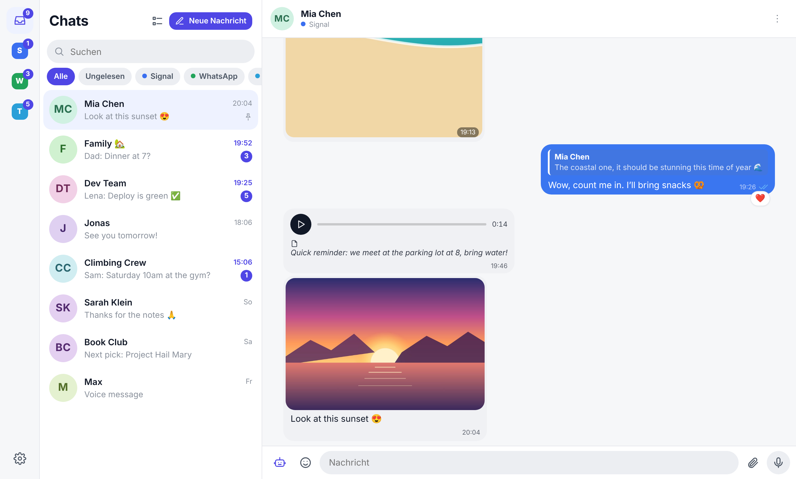
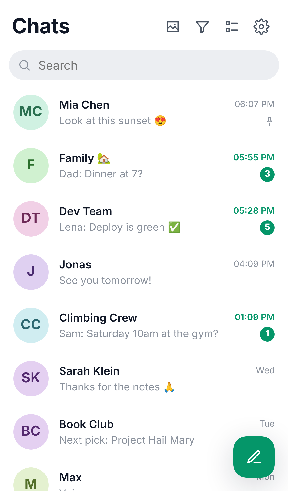
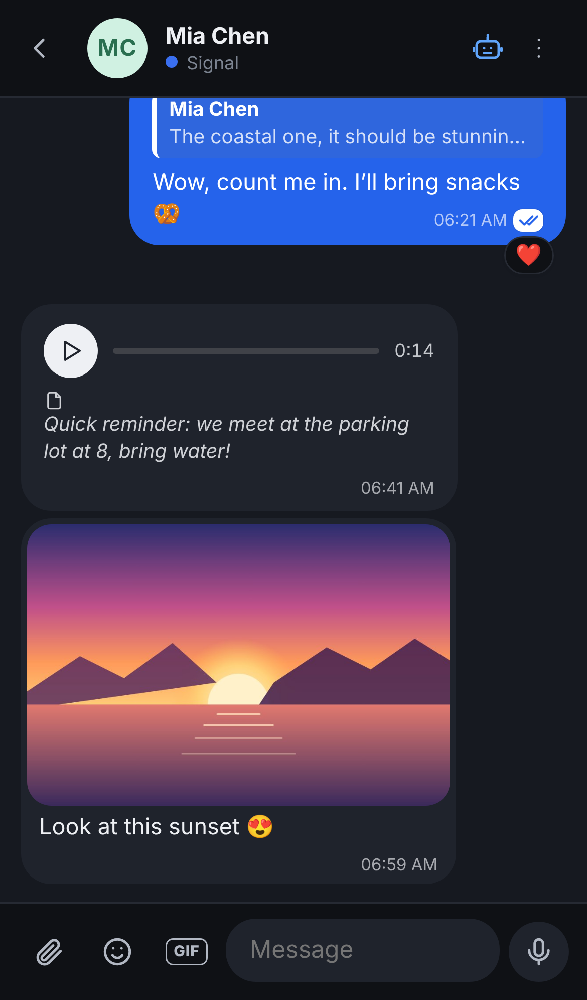
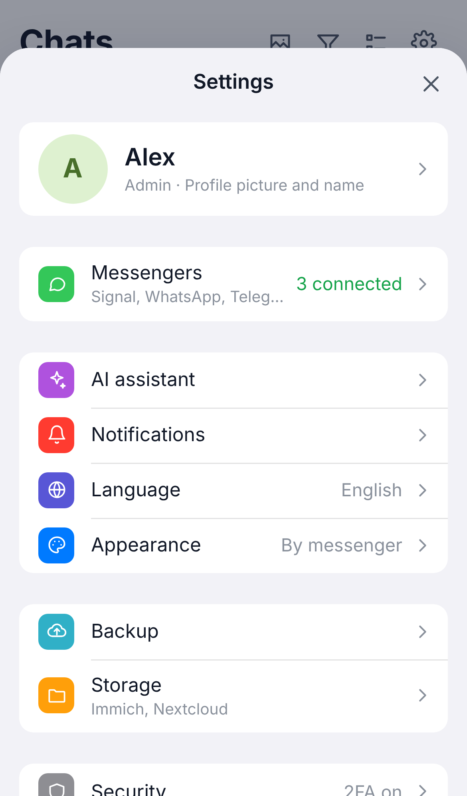

<p align="center">
  
</p>

<h1 align="center">Chorus</h1>

<p align="center">
  <b>Signal, WhatsApp and Telegram in one calm, self-hosted inbox.</b><br />
  End-to-end on your own server · encrypted at rest · installable as an app on your phone
</p>

<p align="center">
  <a href="#quick-start">Quick start</a> ·
  <a href="#features">Features</a> ·
  <a href="#security">Security</a> ·
  <a href="#connecting-your-messengers">Messengers</a> ·
  <a href="README.de.md">Deutsch</a>
</p>

<p align="center">
  
</p>

<p align="center">
  
  &nbsp;
  
  &nbsp;
  
</p>

> **Built with Claude.** Chorus is developed together with [Claude](https://claude.ai), Anthropic's AI model, through Claude Code. A human decides what gets built and tests it every day; Claude writes most of the code.

---

## Why Chorus?

Most of us juggle three messengers. Chorus puts every chat into one inbox that runs on **your** hardware: a Raspberry Pi, a NAS, a small VPS or a Proxmox container. You open it in any browser or install it on your phone's home screen like a native app. Your messages never pass through a third-party service.

The interface is deliberately quiet and iOS-like: soft colours, smooth motion and nothing that blinks for attention.

> The user interface is currently in **German**. An English translation is on the roadmap. Contributions are welcome.

## Features

### Messaging
- **One inbox** for Signal, WhatsApp and Telegram, filterable by messenger (combine several) or "unread"
- Replies, reactions, editing, deleting, read receipts, pinned and muted chats, drafts per chat
- **Swipe gestures** on the phone: left to archive, right to mark as read/unread. Long-press for multi-select, pull down to refresh
- **Archive** that stays quiet: archived chats don't count towards the badge and don't notify
- **Contact profiles** with your own alias, picture and notes; number, status and members come from the messenger
- Profile pictures are fetched automatically and gently, without hitting rate limits
- **Merge contacts** across messengers: the same person on Signal and WhatsApp becomes one chat with a shared history; pick in the contact profile which messenger you reply through (or let Chorus use the one they last wrote on)
- **Send later**: hold the send button and pick a time; scheduled messages wait in the chat until they go out
- **Reminders** on any message ("remind me tomorrow morning"), with a notification that jumps right back to it
- **Search across all messengers**: messages, transcripts and file names, with a jump to the hit in the chat
- **Gallery** of all photos, videos, files, links and voice messages, per chat or across all chats
- **Save to Immich or Nextcloud** (optional): link your own Immich (API key with `asset.upload`) and/or Nextcloud (app password, WebDAV) under Settings → Storage. Photos and videos go to Immich with one tap in the full-screen view, files to a Nextcloud folder of your choice; the server uploads the original, credentials stay encrypted on the server

### Media
- Send photos, videos, voice messages and files (drag & drop or paste on the desktop)
- **Image editor** before sending: crop with fixed ratios, rotate, flip, pen, highlighter, arrows, shapes, text, pixelate, select and move, undo/redo
- **Video editor**: trim with a thumbnail timeline and crop to 1:1, 4:3, 16:9 or 9:16 (cut on the server with ffmpeg)
- Instant upload bubbles with progress, so you never wonder whether something is happening
- Full-screen viewer with swipe-to-close, voice messages at 1.5×/2× with a mini player that keeps playing while you switch chats

### AI assistant (optional, per chat, opt-in)
Bring your own [Anthropic](https://console.anthropic.com) and [ElevenLabs](https://elevenlabs.io) keys:
- **Summarise** a chat: what it's about, what's agreed, what's still open
- **Write for me**: type or dictate "tell her I'm at the gym and will call later" and send it as text or as a voice message **in your own (cloned) voice**. Everything the AI wrote is marked with a 🤖 reaction (on Telegram, which does not allow it as a reaction, with a 🤖 at the end)
- **Suggested replies**, optionally with a direction ("politely decline")
- **Transcribe** voice messages
- **Live translation** per chat: foreign messages get a German translation under the bubble (with the source language), and what you write in German goes out in their language (can be switched off per chat or per message)
- **Ask your chats**: "When did Lisa want to come over?" gets an answer with the messages it is based on
- **Autobot**: Claude answers on your behalf up to a limit you set, in groups you choose what it answers (questions to everyone, only mentions and replies to you, or everything), from whom, under which condition and in which style (like you, short, or creative). Answers are marked with a 🤖 reaction

Nothing is sent to an AI provider unless you enable AI for that chat and press a button.

### Everyday comfort
- Installable **PWA** with Web Push notifications, light and dark mode, bubble colours per messenger
- **Multiple profiles** for family and friends, each with its own password, 2FA, messengers and AI keys. Each profile is encrypted separately, so even the admin can't read other people's chats
- **Export** of your history as HTML or ZIP, automatic saving of media
- Admin area: server health, recent warnings, reconnect messengers, restart

## Security

Chorus is built around a **vault**:

- When you set a password, **your browser** derives a key from it (PBKDF2). The server never sees the password.
- The database is encrypted with **SQLCipher**, files and attachments with **AES-256-GCM**, messenger sessions live encrypted inside the vault. signal-cli works only in RAM (`/dev/shm`).
- After a server restart everything stays locked until you open the app again. Signal and WhatsApp deliver what arrived in the meantime.
- Optional **comfort mode** keeps a key on the server so messages keep flowing after a restart. That is convenient but less strict, so protect the host and its backups.
- **Recovery code** at setup, **TOTP two-factor login** with "trust this device for 30 days", login throttling that can't be abused to lock you out
- Attachments from other people are never executed as web pages on your Chorus origin; strict security headers on every response

If Chorus is reachable from the internet, put it behind a reverse proxy with HTTPS and HSTS. Never expose port 8080 directly.

## Quick start

You need a server with Docker.

```bash
git clone https://github.com/robinvonmises/chorus.git && cd chorus
docker compose up -d
```

Chorus now runs on **`http://<your-server>:8080`**. The first person to open it becomes the admin and sets the password.

Point your reverse proxy (nginx, Caddy, Traefik, Nginx Proxy Manager…) at that port. Browsers only allow the microphone, app installation and notifications over **HTTPS**. If you don't have a proxy, there is a bundled Caddy with a self-signed certificate:

```bash
docker compose --profile https up -d   # https://<your-server>:8443
```

**Try it without real accounts:**

```bash
docker compose build && docker run --rm -p 8080:8080 -e DEMO=1 chorus-chorus
```

**Without Docker** (Debian/Ubuntu, e.g. an LXC container): `bash deploy/install-ohne-docker.sh` installs Node.js, signal-cli, ffmpeg and Caddy and sets up a service. Run it again to update.

**Remote access:** the easiest way is [Tailscale](https://tailscale.com). Install it on the server and on your phone, and no ports need to be opened.

## Connecting your messengers

| | How | Notes |
| --- | --- | --- |
| **Signal** | Scan a QR code (Signal → Settings → Linked devices → +) | Runs as a linked device via [signal-cli](https://github.com/AsamK/signal-cli). Signal doesn't transfer old history, so you see everything from the moment of linking. |
| **WhatsApp** | Scan a QR code or enter a pairing code | Uses the unofficial [Baileys](https://github.com/WhiskeySockets/Baileys) library. **Unofficial clients violate WhatsApp's terms of service and accounts can be banned.** Bans are rare for normal personal use and mostly hit accounts that send bulk or automated messages or are brand new, but they can't be ruled out. Chorus shows this warning and asks for confirmation before linking. Use at your own risk and open WhatsApp on your phone at least every 14 days. |
| **Telegram** | Create an app at [my.telegram.org/apps](https://my.telegram.org/apps), enter `api_id` and `api_hash`, then log in by QR code or phone number | Uses [GramJS](https://github.com/gram-js/gramjs). |

## Configuration

| Variable | Default | Meaning |
| --- | --- | --- |
| `PORT` | `8080` | Port inside the container |
| `DATA_DIR` | `/data` | Vault, database and files |
| `MAX_UPLOAD_MB` | `100` | Maximum upload size |
| `DEMO` | – | `1` = demo chats to play with |
| `TRUST_PROXY` | private networks | Which reverse proxies may set `X-Forwarded-For` |

Updates: `docker compose pull && docker compose up -d`.

**Automatic updates** (Docker setup cloned with git, systemd): `bash deploy/auto-update-einrichten.sh` installs a timer that checks GitHub every minute, waits for the CI image of the new commit, swaps it in and rolls back automatically if the container doesn't become healthy. `data/` and `.env` are never touched. Log: `journalctl -u chorus-update`.

## Architecture

```
Browser / PWA (React 19, Vite)  ──HTTPS/WebSocket──▶  Chorus server (Node 22, Fastify, TypeScript)
                                                        ├─ Signal    → signal-cli (JSON-RPC)
                                                        ├─ WhatsApp  → Baileys
                                                        ├─ Telegram  → GramJS
                                                        ├─ Vault     → SQLCipher + AES-GCM files
                                                        └─ AI        → Anthropic API, ElevenLabs (optional)
```

## Development

```bash
cd server && npm install && DEMO=1 PORT=8099 npm run dev
cd web && npm install && npm run dev        # http://localhost:5173
cd server && npm test
```

The README screenshots use sample data: `node docs/screenshots/capture.cjs http://localhost:8099` (needs Playwright).

## License

Chorus is free software under the [GNU Affero General Public License v3.0](LICENSE). You may use, study, change and share it. If you run a modified version as a service for others, you must offer them its source code.

## Disclaimer

Chorus is an independent hobby project and is not affiliated with Signal, WhatsApp/Meta or Telegram. Their names are used only to describe compatibility.
